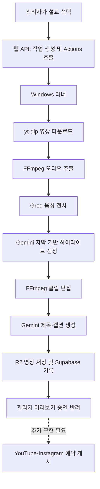

# 설교 쇼츠 자동화 시스템 조사 및 교회 PC 이전

> 조사일: 2026-10-18 · 시간대: Asia/Seoul (KST)
> 조사 기준: 로컬 저장소 `b5ff8fb`, 연결된 Supabase DB, GitHub API, 공식 서비스 문서
> 범위: 기존 시스템 조사와 개선 방향 정리. 아래 제안은 구현 완료나 사용자 확정을 뜻하지 않는다.

## 1. 목표와 결론

사용자의 목표는 유튜브 설교에서 관심을 끌 만한 장면을 골라 쇼츠·릴스로 만들고, 자동으로 게시하는 것이다. 현재 개인 PC에 설치된 러너를 교회 PC에서 운영할 예정이다.

현재 시스템은 **영상 선택 → 쇼츠 후보 자동 제작 → 저장 → 관리자 검수**까지 구현되어 있다. **승인 후 유튜브·인스타그램 게시, 예약 발행, 새 설교의 자동 제작 연결은 아직 없다.**

기존 구조를 활용하되 다음 순서로 보완하는 것이 적절하다.

1. 러너 연결을 복구하고 교회 PC에서 실행 환경을 검증한다.
2. 장면 위치 매칭, 실패 복구, 검수 정보의 정확성을 개선한다.
3. 실제 설교로 영상·음성·자막 품질을 확인한다.
4. 승인 후 유튜브 게시를 연결하고, 이어서 릴스 게시를 연결한다.
5. 새 설교 감지와 자동 제작을 연결한다.
6. 운영 결과를 확인한 후 품질 기준을 통과하는 클립부터 완전 자동 게시를 검토한다.

초기 운영 방식으로는 **자동 제작 → 사람 검수 → 승인 시 자동 예약 게시**를 권장한다. 교회 PC는 다운로드와 영상 편집을 담당하고, 웹사이트·DB·R2는 현재 구성을 활용한다.

## 2. 조사 방법과 확인 범위

| 구분 | 수행 내용 |
|---|---|
| 코드 | 쇼츠 스크립트, Actions 워크플로, API, 관리자 화면, DB 마이그레이션, 설교 동기화 코드 확인 |
| DB | 쇼츠 작업·클립·설정 테이블을 읽기 전용으로 조회 |
| GitHub | 실행 이력, 등록 러너, Secret 이름, 연결 계정의 저장소·조직 권한 조회 |
| 영상 접근 | 기존 클립 URL 3개에 HEAD 요청, HTTP 200 및 `video/mp4` 확인 |
| 장면 매칭 | 현재 매칭 함수를 메모리에서 실행하여 짧은 부분 문자열이 잘못 선택되는 사례 재현 |
| 편집 점검 | 짧은 합성 영상으로 일부 FFmpeg 필터 동작 확인 |
| 외부 규격 | GitHub 러너·대기열, YouTube 업로드·Shorts, Meta 게시 문서 확인 |

실제 설교 전체 파이프라인, 유료 AI 생성, 유튜브·인스타그램 게시, 교회 PC 설치는 실행하지 않았다. DB·계정·운영 설정도 변경하지 않았다. 이번 문서화에서는 조사 문서만 추가했다.

다음은 구분해서 해석해야 한다.

- 과거 Actions 성공은 당시 코드가 실행 완료되었다는 의미이며, 출력 품질이나 현재 코드의 종단 검증을 보장하지 않는다.
- 클립 URL의 HEAD 성공은 파일 접근 확인이다. 재생 화면·자막·싱크를 검수했다는 의미가 아니다.
- 반려 9건의 구체적인 원인은 저장된 사유만으로 판단할 수 없다.
- 아래 DB 수치와 계정 권한은 조사 시점의 스냅샷이다.

## 3. 현재 구현과 처리 흐름

Groq 전사가 실패하면 YouTube 한국어 자동자막 다운로드로 대체한다.

| 단계 | 구현 내용 | 상태 |
|---|---|---|
| 설교 목록 동기화 | YouTube 목록을 `sermon_videos`에 저장 | 구현됨. 쇼츠 제작은 자동 시작하지 않음 |
| 제작 요청 | 관리자 화면에서 영상 선택, `workflow_dispatch` 호출 | 수동 시작 |
| 다운로드 | yt-dlp로 최대 1080p 영상 다운로드, 오디오 추출 | 구현됨 |
| 음성 전사 | Groq `whisper-large-v3`, 용량 초과 시 분할, 자동자막 대체 경로 | 구현됨 |
| 장면 선정 | Gemini `gemini-2.5-flash`, 인용문으로 시간 매칭 | 구현됨. 정확도 개선 필요 |
| 영상 편집 | 1080×1920 캔버스, 중앙 정사각형 영상, 자막, 단어 강조, 상단 문구, BGM, 로고 | 구현됨. 실제 출력 재검증 필요 |
| 저장 | R2에 MP4 저장, Supabase에 클립 정보 저장 | 구현됨 |
| 검수 | 미리보기, 승인, 반려 및 사유 저장 | 구현됨. 자막 정보 오류 있음 |
| 플랫폼 게시 | 유튜브·릴스 업로드 및 결과 저장 | 미구현 |
| 예약·자동 발행 | 발행 시각, 플랫폼별 재시도, 일일 상한 적용 | 미구현 |

기본 후보 수는 5개다. 선정 프롬프트는 30~55초를 요청하고, 실제 시간 검증은 20~70초를 허용한다. 침묵 제거 후 영상 길이는 원본에서 선택한 구간 길이와 달라질 수 있다.

워크플로와 실행 스크립트에는 개수 입력이 있지만, 관리자 화면·트리거 API는 해당 값을 전달하지 않는다. `highlight_count` 마이그레이션만으로 사용자 화면의 5개·10개 선택이 완성된 것은 아니다.

## 4. 실제 운영 상태

### 4.1 DB 조회 결과

| 대상 | 상태 | 건수 |
|---|---|---:|
| 작업 | 검수 대기 `ready_for_review` | 3 |
| 작업 | 실패 `failed` | 8 |
| 작업 | 대기 `pending` | 3 |
| 작업 합계 | | **14** |
| 클립 | 검수 대기 `pending` | 5 |
| 클립 | 반려 `rejected` | 9 |
| 클립 합계 | | **14** |
| 클립 | `youtube_video_id` 기록 있음 | 0 |
| 클립 | `published_at` 기록 있음 | 0 |

대기 작업 3건은 6월 6일부터 상태가 남아 있었다. 최근 실패 2건에는 외부 프로세스 시간초과인 `ETIMEDOUT`가 기록되어 있었다. 이 사실만으로 모든 실패 원인을 현재 코드에 동일하게 적용해서는 안 된다.

설정값은 `auto_publish=false`, `max_clips_per_sermon=5`, `daily_publish_limit=5`다. 다만 해당 설정을 읽어 제작·게시를 제어하는 런타임 코드는 확인되지 않았다. 설정값만 바꿔도 자동 게시가 시작되는 구조가 아니다.

게시 기록 0건은 **이 시스템에 기록된 내역**이다. 사용자가 플랫폼에서 별도로 수동 게시했는지는 조사하지 않았다.

### 4.2 GitHub 실행 상태

- 가장 최근 확인된 실행: **2026-06-13 22:44 KST 시작**, 성공.
- 해당 실행의 러너: **`YEO-PC`**.
- [최근 성공 실행 기록](https://github.com/msvchweb/msvch/actions/runs/27468481322)
- 이후 8월에 R2 업로드와 의존성 설치 방식이 변경되어, 위 성공 기록만으로 현재 버전의 전체 동작을 보장할 수 없다.
- 조사 시점 저장소 러너 조회 결과: **등록 러너 0대**.

개인 PC에 러너 프로그램이 설치되어 있다는 사용자 설명과 GitHub의 등록 상태는 별개의 정보다. 교회 PC 설치 시 저장소 등록 및 온라인 연결을 새로 확인해야 한다.

## 5. 확인된 문제와 개선 우선순위

### 5.1 우선순위 높음

| 문제 | 확인 근거와 영향 | 권장 개선 |
|---|---|---|
| 인용문이 잘못된 시간을 가리킬 수 있음 | `findSegmentIndex`가 양방향 부분 포함을 먼저 검사한다. 긴 문장보다 먼저 등장한 짧은 자막을 선택할 수 있음 | 정확한 전체 일치 우선, 자막 구간 ID로 위치 지정, 시작·끝을 하나의 구간으로 검증 |
| 실패한 영상의 재시도 차단 | 트리거 API가 상태와 무관하게 같은 `video_id`의 기존 작업을 거부 | 실패 작업 재시도 경로, 재실행 이력과 시도 횟수 관리 |
| 상태 변경만으로 재실행되지 않음 | `repair-shorts-jobs.ts`는 DB 상태만 `pending`으로 변경. 이를 감시해 실행하는 워커는 없음 | 실제 Actions 재호출 또는 작업 대기열 처리 연결 |
| 승인 후 게시 누락 | 승인 API는 `review_status=approved`만 기록 | 플랫폼별 게시 작업과 성공 ID·URL·발행 시각 저장 |
| 중단·실패와 DB 상태 불일치 | 스크립트 실행 전 실패, 취소, 강제 종료에 대한 워크플로 차원의 상태 동기화가 없음 | 실행 ID 기록, 종료 상태 반영, 오래된 작업 감지, 재시도 가능 상태 구분 |

인용문 매칭 재현 사례:

| 자막 후보 | 시간 | 내용 |
|---|---:|---|
| 앞쪽의 짧은 자막 | 70초 | 하나님은 |
| 실제 일치하는 문장 | 180초 | 하나님은 여러분을 결코 포기하지 않으십니다 |

두 번째 문장 전체를 인용문으로 넣었지만 현재 함수는 첫 번째 후보를 반환했다. 이는 현재 함수의 재현 결과이며, 기존 반려 클립이 모두 이 원인으로 생성되었다는 의미는 아니다.

권장 방식은 AI에게 자막 구간 ID와 실제 인용문을 함께 선택하게 하고, 코드에서 존재 여부·순서·길이·문맥을 검증하는 것이다. 앞뒤가 뒤집히는 응답을 단순 교환해 채택하기보다 다시 선정하거나 제외하는 편이 신뢰도를 높인다.

### 5.2 우선순위 중간

| 문제 | 확인 내용 | 권장 개선 |
|---|---|---|
| 검수 화면의 자막 정보 오류 | `transcript`에 실제 발언 대신 `h.reason`을 저장 | 실제 발언과 선정 이유를 별도 저장·표시 |
| 훅 정보가 실제 도입부 편집에 연결되지 않음 | `hook`, `peak_sec`를 생성하지만 해당 값에 따른 도입부 편집은 없음. `card_text`는 표시됨 | 원문의 의미를 유지하면서 첫 문장·상단 문구·도입부를 함께 평가 |
| 메타데이터의 개수·내용 검증 부족 | 프롬프트가 5개로 고정, 응답을 타입 단언만으로 사용. `title_yt`는 생성 후 저장하지 않음 | 실제 성공 클립 수 반영, 응답 스키마·개수 검증, 게시 제목 보존 |
| 재실행 시 중복 저장 가능 | 클립을 항상 INSERT하며 작업·클립 인덱스의 고유 제약이 없음 | 같은 시도 재처리의 중복 방지, 재편집 버전 구분 |
| 재편집 파일의 캐시 충돌 가능 | 같은 R2 키에 저장하며 업로더는 긴 `immutable` 캐시 정책 사용 | 내용·버전이 바뀌면 새로운 파일 키 사용 |
| 대기 작업 취소 가능 | 공통 concurrency 그룹, `cancel-in-progress=false`, 별도 queue 설정 없음 | 현재 GitHub의 `queue: max` 적용 검토 및 취소 결과 DB 반영 |
| 음성·영상 싱크 미검증 | 과거 세션 로그에 미해결 문제. 침묵 제거 미적용 경로에 명시적 PTS 정규화가 없음 | 실제 설교로 두 경로를 비교 재현한 뒤 원인에 맞게 수정 |
| 서비스 오류 기록 부족 | 일부 API 호출에 명시적 타임아웃·재시도가 없고 `updateJob`의 반환 오류를 검사하지 않음 | 제한된 재시도, 단계별 시간·오류·전사 출처 기록 |

GitHub 기본 동시 실행 제한은 모든 요청을 보존하는 대기열이 아니다. 기존 대기 실행이 새 요청으로 교체될 수 있다. 조사 시점 공식 문서에는 `queue: max`를 통해 최대 100개 실행을 대기시키는 옵션이 설명되어 있다. 실제 적용 시 현재 문서를 다시 확인한다. [GitHub 대기열 문서](https://docs.github.com/en/actions/reference/workflows-and-actions/workflow-syntax#concurrency)

싱크 문제는 **현재 실제 설교에서 재현 완료된 결함으로 단정하지 않는다.** 또한 검정 배경의 `d=1`만으로 영상이 1초에 끝난다고 판단해서는 안 된다. 해당 합성 필터 점검에서는 4초 입력의 영상 약 4.04초·음성 4초가 출력되었으며, 이것 역시 실제 설교의 싱크 검증을 대체하지 않는다.

## 6. 후킹 장면 선정과 편집 품질 개선 방향

현재 모델 입력은 자막이다. 목소리의 강약, 표정, 청중 반응, 화면 구도는 선정 근거에 직접 포함되지 않는다. 모델 교체만으로 해결하기보다 다음 흐름을 권장한다.

### 6.1 후보 발굴 → 평가 → 최종 선정

1. 자막에서 후보 10~15개를 넉넉히 찾는다. 수량은 제안값이다.
2. 아래 기준으로 후보를 비교하고 상위 3~5개를 선정한다.
3. 품질이 낮으면 정해진 개수를 억지로 채우지 않는다.
4. 선정된 후보에만 음성·영상 검사를 적용해 처리량을 줄인다.

| 평가 기준 | 확인할 질문 |
|---|---|
| 첫 1~3초 | 바로 이해되는 질문·갈등·뜻밖의 발언·구체적인 사례가 있는가? |
| 독립적인 이해 | 앞 설교를 듣지 않은 사람도 이해할 수 있는가? |
| 공감 | 일상 경험이나 고민과 연결되는가? |
| 완결성 | 핵심 답변·적용까지 담기고 자연스럽게 끝나는가? |
| 문맥 보존 | 원래 설교의 의미와 결론을 왜곡하지 않는가? |
| 중복 | 같은 설교의 다른 클립과 메시지·구간이 겹치지 않는가? |
| 영상·음성 | 얼굴 잘림, 긴 침묵, 정지 화면, 발음·자막 문제가 없는가? |

“그런데 그것은…”처럼 앞 문맥에 의존하는 시작을 피하고, 부정문·반어법·인용 뒤의 설명을 잘라 의미가 반대로 전달되지 않도록 앞뒤 문맥을 검토한다. 훅 문구는 실제 발언과 구분하고, 원문에 없는 말을 설교자의 발언처럼 표시하지 않는다.

### 6.2 편집과 검수

- 한국어 문장과 호흡에 맞춰 자막을 나누고, 성경 인명·지명 등 전사 오류를 교정할 수 있게 한다.
- 현재 중앙 정사각형 크롭을 검증하고, 이동하는 설교자나 화면 구성이 다른 영상의 처리 방식을 정한다.
- 실제 최종 파일 길이, 해상도, 오디오 유무를 확인한다. DB의 원본 구간 길이를 최종 출력 길이로 간주하지 않는다.
- 검수 화면에서 원본 시점, 실제 발언, 선정 이유, 제목·캡션을 함께 확인하고 필요한 부분을 수정하게 한다.
- 반려 사유를 문맥 부족·후킹 약함·자막 오류·구도·싱크 등으로 남겨 다음 선정에 활용한다.

게시 후에는 단순 조회수뿐 아니라 가능한 시청 지속·반응 지표와 승인·반려 결과를 함께 살핀다. 자동으로 흥행을 보장하는 기능이 아니라, 교회 콘텐츠에 맞는 선정 기준을 운영 결과로 개선하는 구조다.

### 6.3 길이와 BGM

YouTube는 정사각형 또는 세로 영상에 대해 최대 3분 Shorts를 지원하므로, 60초가 절대적인 기술 상한은 아니다. 다만 초기 운영은 메시지가 완결되는 짧은 구간부터 품질을 검증한다. 1분 초과 Shorts에 활성 저작권 클레임이 있으면 차단될 수 있으므로, 현재 포함된 BGM 4개는 유튜브·인스타그램 게시에 사용할 수 있는 출처와 이용 조건을 확인해야 한다. 음원의 이용 권한은 이번 조사에서 확인하지 않았다. [YouTube Shorts 공식 안내](https://support.google.com/youtube/answer/15424877)

## 7. 게시 자동화 연결 방향

### 7.1 YouTube

- 교회 채널 관리 권한이 있는 Google 계정으로 업로드 권한을 승인한다.
- 현재 영상 목록 조회용 `YOUTUBE_API_KEY`와 OAuth 업로드 인증은 별개다.
- 업로드 결과의 영상 ID, 공개 상태, 게시 시각을 저장한다.
- 초기 검증은 비공개 영상으로 진행하고, 이후 승인된 콘텐츠의 예약·공개 절차를 연결한다.
- 업로드 성공 후 DB 기록 실패 등의 상황에서 재업로드하기 전에 기존 결과를 확인하도록 한다.

[YouTube 업로드 API 공식 문서](https://developers.google.com/youtube/data/reference/rest/v3/videos/insert)

### 7.2 Instagram Reels

- 교회 인스타그램 프로페셔널 계정과 게시 권한 연결이 필요하다.
- Instagram Login 또는 Facebook Login 방식 중 계정 구성에 맞는 방식을 선택한다. Facebook Login을 선택할 경우 관련 Facebook 페이지·권한도 확인한다.
- 영상 컨테이너 생성 → 처리 상태 확인 → 게시 → 결과 ID 저장 흐름을 구현한다.
- Meta가 가져갈 수 있는 영상 URL과 형식을 검증한다.
- 토큰 갱신과 재연결이 필요한 상태를 운영자가 확인할 수 있게 한다.

[Meta 공식 Instagram API 자료](https://www.postman.com/meta/instagram/documentation/6yqw8pt/instagram-api?entity=request-23987686-af579d08-121e-4897-8f45-5fd41ace49df) · [Reels 게시 절차](https://www.postman.com/meta/instagram/request/gabnx7r/publish-reel)

### 7.3 공통 운영 원칙

- 플랫폼별로 발행 상태를 구분한다. 유튜브 성공·릴스 실패 시 릴스만 재시도한다.
- 승인 상태와 게시 상태를 분리한다. 승인만으로 발행 완료를 표시하지 않는다.
- 예약 시각은 KST 기준으로 입력·표시하고 저장 시각과 일관되게 변환한다.
- 일일 발행 상한, 중복 게시 방지, 토큰 만료·게시 실패 알림을 연결한다.
- 러너가 꺼져 있을 때 예약 발행까지 멈출지 결정한다. 제작은 교회 PC에서 하고, 생성 완료 후 발행 처리는 PC 가동 시간과 분리하는 구성을 우선 검토한다. 대용량 유튜브 업로드 실행 위치는 호스팅의 시간·전송 제한을 확인한 뒤 정한다.

## 8. 교회 PC 이전 준비

현재 워크플로는 `runs-on: [self-hosted, windows, shorts]`, Node 24, 전체 작업 제한 60분을 사용한다.

| 준비 항목 | 확인 사항 |
|---|---|
| 운영체제 | 현재 설정은 Windows. 다른 OS라면 워크플로와 실행 환경 수정 필요 |
| Windows 계정 | 러너를 실행할 작업용 계정, 서비스 설치 권한, 작업 폴더 접근 권한 |
| GitHub 등록 | `msvchweb/msvch` 저장소에 등록, 사용자 정의 라벨 `shorts` 지정 |
| 도구 | Node 24 실행 환경, yt-dlp, FFmpeg·ffprobe, 한국어 폰트 |
| 폰트 | 현재 ASS 자막은 `Noto Sans CJK KR` 지정. 서비스 계정에서도 사용 가능한지 확인 |
| 저장 공간 | 원본 영상·오디오·클립을 저장할 여유 공간과 임시 파일 정리 |
| 전원 | 절전·최대 절전·재부팅 후 서비스 시작 확인 |
| 네트워크 | 교회 회선에서 YouTube 다운로드, AI API, GitHub, Supabase, R2 접근 확인 |
| 방송 겸용 여부 | 송출과 CPU 인코딩이 겹치지 않게 실행 시간·자원 사용 조정 |

현재 전사와 장면 선정은 외부 API에서 처리하며, 편집은 `libx264` CPU 인코딩이다. 현재 코드 기준 GPU는 필수가 아니다. 교회 PC의 실제 사양과 성능은 아직 확인하지 않았다.

### 8.1 설치 순서

1. 개인 계정으로 [저장소 러너 설정](https://github.com/msvchweb/msvch/settings/actions/runners)에 접속한다.
2. **New self-hosted runner → Windows**를 선택한다.
3. 교회 PC의 관리자 PowerShell에서 GitHub가 제시하는 다운로드·등록 명령을 실행한다. 설치 경로는 서비스 계정이 접근하기 쉬운 `C:\actions-runner` 등을 사용한다.
4. 사용자 정의 라벨에 **`shorts`**를 지정한다. 개인 PC와 병행하면 `church` 같은 추가 라벨로 대상을 구분하고, 필요 시 워크플로 조건을 맞춘다.
5. 설정 과정에서 **Windows 서비스로 실행**하도록 선택한다.
6. 실제 서비스 계정에서 도구 경로·폰트·임시 디렉터리 접근을 확인한다.
7. 재부팅 후 로그인하지 않은 상태에서도 러너가 온라인인지 확인한다.
8. 설교 한 편을 검수 대기 단계까지 실행하고, 실패 복구까지 확인한다.

등록 토큰은 GitHub가 발급하는 단기 토큰이다. 만료되면 다시 발급하며, 문서·소스 저장소에 기록하지 않는다. 브라우저의 GitHub 로그인을 계속 유지할 필요는 없다. [GitHub 러너 등록](https://docs.github.com/en/actions/how-tos/manage-runners/self-hosted-runners/add-runners) · [Windows 서비스 설정](https://docs.github.com/en/actions/how-tos/manage-runners/self-hosted-runners/configure-the-application)

## 9. 교회 PC에서 필요한 서비스 로그인과 인증

| 서비스 | 교회 PC 로그인 | 인증·운영 방식 |
|---|---|---|
| Windows | 작업용 계정 필요 | 서비스 설치 후 사용자 대화형 로그인 없이 실행하도록 구성 가능 |
| GitHub | 최초 등록을 위한 관리자 접근 필요 | 등록 명령은 다른 PC에서 준비 가능. 지속적인 브라우저 로그인은 불필요 |
| Google AI Studio / Gemini | 불필요 | GitHub Secrets의 API 키 |
| Groq | 불필요 | GitHub Secrets의 API 키 |
| Supabase | 불필요 | GitHub Secrets의 서버용 키 |
| Cloudflare R2 | 불필요 | GitHub Secrets의 업로드용 자격증명 |
| 교회 홈페이지 관리자 | 검수할 때 필요 | 개인 PC·휴대폰 등에서도 검수 가능 |
| YouTube / Google | 게시 기능 도입 시 최초 연결 승인 | 교회 채널 권한이 있는 계정의 OAuth 인증. 교회 PC에서 승인할 필요는 없음 |
| Instagram / Meta | 게시 기능 도입 시 최초 연결 승인 | 선택한 로그인 방식에 맞는 계정·게시 권한과 토큰 관리 |

현재 GitHub 저장소에는 아래 Secret 이름이 등록되어 있음을 확인했다. **이름의 존재를 확인했으며 값의 유효성을 모두 검증한 것은 아니다.**

- `GEMINI_API_KEY`, `GROQ_API_KEY`
- `NEXT_PUBLIC_SUPABASE_URL`, `SUPABASE_SERVICE_ROLE_KEY`
- `R2_ACCOUNT_ID`, `R2_ACCESS_KEY_ID`, `R2_SECRET_ACCESS_KEY`, `R2_BUCKET`
- `NEXT_PUBLIC_CDN_BASE_URL`

이 값은 워크플로 실행 시 주입되므로 각 서비스 대시보드에 교회 PC로 로그인하거나 개인 PC의 `.env.local` 전체를 복사하는 방식은 필요하지 않다.

별도로, 웹사이트가 Actions를 호출하는 `GITHUB_PAT`는 웹서버 측 인증이다. 러너 등록 인증과 다르므로 이전 완료 후 관리자 화면의 실제 트리거가 정상 호출되는지 확인해야 한다.

## 10. GitHub owner 로그인 불가 상황에 대한 확인

사용자는 다른 owner 계정의 비밀번호를 잊어 로그인하지 못하지만 개인 계정에는 로그인할 수 있다고 설명했다. 현재 연결된 개인 계정의 권한을 직접 조회한 결과는 다음과 같다.

| 항목 | 조회 결과 |
|---|---|
| 연결된 개인 계정 | `ymg0924` |
| 저장소 | `msvchweb/msvch` |
| 저장소 소유자 종류 | Organization |
| 저장소 권한 | `admin: true` |
| `msvchweb` 조직 멤버십 | `state: active`, `role: admin` |

GitHub 조직 멤버십 API의 `role: admin`은 **조직 Owner**를 뜻한다. 따라서 조사 시점에는 **`ymg0924`도 이미 조직 Owner이며 저장소 관리자 권한을 갖고 있다.**

이 계정으로 교회 PC 러너를 등록할 수 있는 권한이 확인되었다. 다른 계정의 비밀번호 복구를 러너 설치의 선행 조건으로 삼을 필요는 없다. 조직 정책과 실제 등록 성공 여부는 설치 시 최종 확인한다.

[조직 Owner 역할의 공식 정의](https://docs.github.com/en/rest/orgs/members#set-organization-membership-for-a-user) · [조직 저장소 러너 등록 권한](https://docs.github.com/en/actions/how-tos/manage-runners/self-hosted-runners/add-runners)

## 11. 권장 진행 단계와 완료 기준

아래는 후속 실행을 위한 제안이며, 이번 문서 작성에서 수행한 작업 목록이 아니다.

| 단계 | 작업 | 완료 판단 기준 |
|---|---|---|
| 1. 연결 복구·이전 | 교회 PC 등록, 도구·서비스·Secret 연결 확인 | 재부팅 후 온라인, 관리자 화면에서 작업 전달 성공 |
| 2. 정확성·복구 | 인용 매칭, 실제 자막 저장, 재시도, 상태 동기화, 중복 방지 | 반복 문구에서도 올바른 구간 선택, 실패 후 재실행, 중복 클립 없음 |
| 3. 출력 품질 | 자막·싱크·구도·음량 확인, 실패 경로 검증 | 실제 설교에서 침묵 제거 두 경로 모두 검수 통과 |
| 4. 유튜브 게시 | OAuth 연결, 업로드, 상태 저장, 예약 연결 | 비공개 테스트 성공 및 승인된 클립의 예약·공개 확인 |
| 5. 릴스 게시 | 계정 권한, 컨테이너 처리, 게시, 결과 저장 | 릴스 게시 확인, 한 플랫폼만 실패해도 독립 재시도 |
| 6. 자동 제작 연결 | 설교 동기화 후 신규 대상 작업 생성 | 중복 제작·쇼츠 재입력 없이 새 설교만 처리 |
| 7. 운영 개선 | 승인·반려와 게시 반응 반영 | 운영 데이터에 근거해 품질 기준·발행 빈도 조정 |

자동 제작 연결 시에는 교회 설교만 대상으로 할지, 예배 전체 영상도 포함할지 범위를 정해야 한다. 같은 채널에 게시한 쇼츠를 다시 원본 설교로 처리하지 않는 필터도 필요하다.

## 12. 아직 확인하거나 결정할 항목

- 교회 PC의 Windows 버전, CPU·메모리·디스크, 가동 시간, 방송용 PC 겸용 여부.
- 현재 출력의 실제 자막·영상·음성 싱크와 교회 회선에서의 다운로드 성공 여부.
- 새 러너에서 현재 R2 업로드 방식까지 포함한 전체 파이프라인 동작.
- 교회 YouTube 채널의 연결 계정, Instagram 프로페셔널 계정 상태와 로그인 방식.
- BGM의 출처 및 두 플랫폼 게시에 대한 이용 조건.
- 설교 한 편당 후보 수, 최종 발행 수, 검수 담당자, 발행 빈도·시각.
- 예약 게시 실행 위치와 교회 PC가 꺼져 있을 때의 처리 정책.
- 완전 자동 게시를 허용할 품질 기준. 초기 사람 검수 운영은 권장안이며 사용자 확정 사항은 아니다.

## 13. 코드 근거

| 파일 | 관련 내용 |
|---|---|
| [Actions 워크플로](.github/workflows/sermon-shorts.yml) | 수동 호출, 러너 라벨, 동시 실행 제한, Secret 주입 |
| [전체 파이프라인](scripts/shorts/run.ts) | 단계 진행, 전사 대체 경로, 상태 기록, 검수 대기 종료 |
| [다운로드](scripts/shorts/download.ts) | yt-dlp 다운로드와 FFmpeg 오디오 추출 |
| [전사](scripts/shorts/transcribe.ts) | Groq 호출, 오디오 분할, 자막 저장 |
| [하이라이트 선정](scripts/shorts/highlight.ts) | 프롬프트, 인용 매칭, 길이·중복 검증 |
| [편집](scripts/shorts/edit.ts) | 크롭, 자막, BGM, 침묵 제거, 영상 인코딩 |
| [메타데이터](scripts/shorts/metadata.ts) | 제목·캡션 생성, 고정 개수 프롬프트 |
| [저장](scripts/shorts/upload.ts) | R2 업로드, 클립 INSERT, 자막 필드 저장 오류 |
| [R2 업로더](scripts/lib/r2.ts) | 파일 URL, 인증, 캐시 정책 |
| [제작 요청 API](src/app/api/shorts/trigger/route.ts) | 기존 영상 차단, 작업 생성, Actions 호출 |
| [승인 API](src/app/api/shorts/%5Bid%5D/approve/route.ts) | 승인 상태만 변경 |
| [관리자 화면](src/app/admin/shorts/page.tsx) | 수동 제작, 미리보기, 승인·반려 |
| [복구 스크립트](scripts/repair-shorts-jobs.ts) | 상태 초기화만 수행 |
| [설교 동기화](src/app/api/admin/cron/sync-sermons/route.ts) | 영상 목록 저장, 쇼츠 자동 제작 연결 없음 |
| [초기 스키마](supabase/migrations/005_shorts.sql) | 작업·클립·설정 테이블, 원본 구간 기반 길이 |
| [개수 컬럼](supabase/migrations/042_shorts_highlight_count.sql) | `highlight_count` 추가 |
| [과거 세션 기록](SESSION_LOG.md) | 이전 실행·싱크 문제 기록. 현재 실행 결과와 구분 필요 |

외부 서비스의 기능·권한·규격은 변경될 수 있으므로 실제 구현 시 각 절의 공식 문서를 다시 확인한다.
